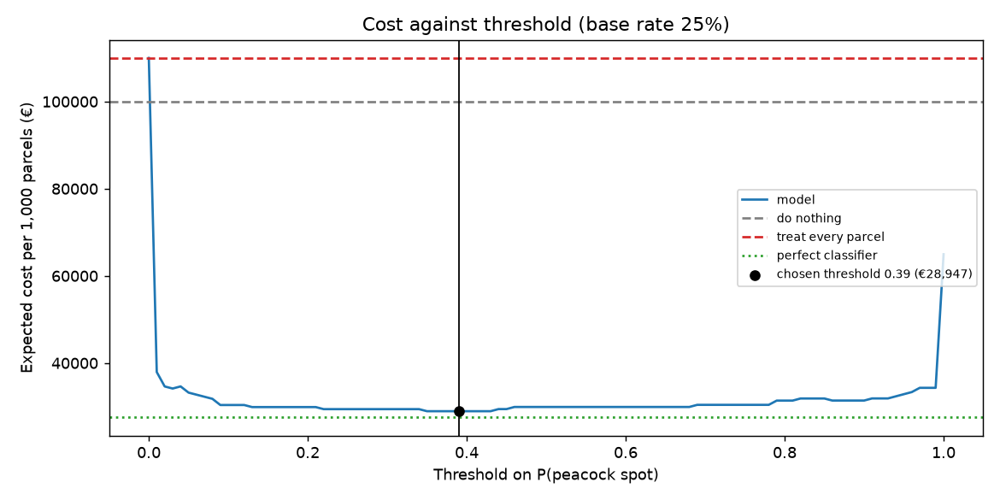
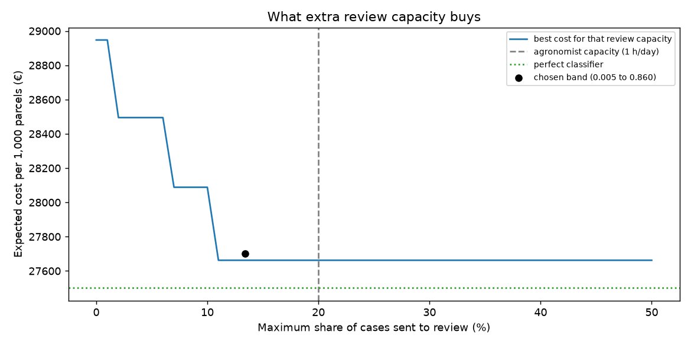

# Assignment 2 Report

*Delete this italic guidance as you fill in each section. You'll be asked to
defend any of this without your code in front of you. Write only what you
can actually explain.*

- **Name**: Sofia Hervas Sanchez
- **Student ID**:18936
- **Email**:shervas.ieu2022@student.ie.edu
- **Group**: BBADBA 5B 

## Business problem, and the cost of being wrong

**Decision.** An agricultural cooperative in Andalucia employs a field technician
who visits members' olive groves in autumn and spring, when olive peacock spot ( also known as repilo) spreads with humidity. At each parcel the technician
picks a sample of leaves, photographs one with a white card behind it with the phone, and must
decide: **apply a copper treatment to the parcel, or not**. The model classifies
the leaf as healthy, Aculus olearius or peacock spot; the decision depends on the
probability of peacock spot. Unclear cases are sent to the cooperative's
agronomist.

**Positive class: peacock spot.** Aculus olearius is detected but does not trigger
treatment: in oil olives its damage is generally not significant and rarely needs a
specific treatment (it matters mainly for table olives and nursery plants). The
technician only logs it for monitoring.

**What a false negative costs (~€400/ha).** Missing peacock spot lets it defoliate
the trees, which reduces this harvest and weakens the next one. Historical average
losses in Spain are around 6% of production, and the "repilos" together cause more
than 10%, with catastrophic years locally. A traditional irrigated grove produces
about 6,000 kg of olives per ha at a 21% oil yield (≈1,260 kg oil/ha), worth ≈€4,000/ha
at the current origin price of ≈€3.20/kg (Poolred, October 2026). A 10% loss is
≈€400/ha.

**What a false positive costs (~€110/ha).** An unnecessary copper spray: product,
diesel and labour. Phytosanitary treatments cost ≈€155–200/ha per year across 2–3
applications in AEMO's cost study, and agricultural inputs have risen by more than
70% since. It also uses up the EU copper allowance (max. 28 kg Cu/ha over 7 years),
which a grower may need in a wet year.

**Asymmetry.** Treating costs €110 whether or not the parcel is infected; not
treating costs €400 only if it is. So treating pays off when
P(peacock spot) × 400 > 110, i.e. P > 0.275, well below 0.5. This break-even moves
with the olive oil price: at double the price (a missed case costs ~€800) it drops
to 0.14; at half the price (~€200) it rises to 0.55.

**How often the positive case occurs.** I assume about 25% of the parcels the
technician visits actually need a copper treatment. Visits are not random: the
technician is mostly called to parcels where the grower already suspects a
problem. This base rate drives the cost analysis below, where I also test how the
answer changes between 5% and 60%.

## Dataset

**Source.** Roboflow Universe, workspace `project-9k7w7`, project `olive1-ngwty`,
version 1 (classification, CC BY 4.0):
https://universe.roboflow.com/project-9k7w7/olive1-ngwty

**What one image is.** A single olive leaf photographed on a plain light
background, labelled with one of three classes: `Healthy`, `aculus_olearius` or
`olive_peacock_spot`. The task is image classification, so I use `yolo11n-cls`.
A leaf dataset with the same three classes and a similar size (~3,400 leaves) has
been used in published research on olive disease classification, which gives me
some confidence in the labels.

**Why it serves the decision, not just resembles it.** The technician's decision
is made from a leaf, and peacock spot is diagnosed from its visible lesions on the
leaf surface, so a leaf-level classifier matches how the decision is actually
taken. The main gap is the background: these are lab-style photos on white, while
a phone in the field would see branches, sky and shade. I close that gap with the
protocol itself: the technician photographs the sampled leaf on a white card.
This costs a few seconds per parcel and makes production images resemble the
dataset. What the card does not remove (a different phone, lighting, olive
varieties not in the dataset) is discussed under limitations.

## What the dataset's composition implies

| Class | Train (originals) | Train (files on disk) | Val | Test |
|---|---|---|---|---|
| Healthy | 756 | 2,268 | 49 | 86 |
| aculus_olearius | 746 | 2,238 | 42 | 88 |
| olive_peacock_spot | 1,242 | 3,726 | 67 | 149 |
| **Total** | **2,744** | **8,232** | **158** | **323** |

**The headline split is misleading.** Roboflow reports 94/2/4, but the train split
contains 3 augmented copies of every photo. Counting distinct originals, the real split is 85/5/10 over 3,225 photos. I checked
that no original appears in more than one split: train/val, train/test and val/test
overlaps are all 0, so there is no leakage. All images are 224×224 (stretched by
Roboflow); one leaf fills a large part of the frame, but early peacock spot
lesions are only a few pixels at this resolution.

**Consequences.**
- *Peacock spot is the majority class* (46% of test). The trivial majority baseline
  therefore always predicts peacock spot, which in business terms means "treat every
  parcel". It is a meaningful baseline and I price it in euros later.
- *The test base rate (46%) is not the production base rate (25%).* Costs computed
  directly on the test set would overweight positives, so I reweight the test
  results to the assumed base rate.
- *Per-class numbers have wide error bars.* With 86–149 test images per class, a
  95% recall carries roughly ±4–5 points of uncertainty, so differences of 2–3
  points between models are not meaningful. Validation is very small (42–67 per
  class), so the choice of best epoch is noisy.
- *Backgrounds differ by class.* Healthy and Aculus leaves are all on the same
  uniform light paper; peacock spot images include dark vignetting, a wooden table
  and bluish backgrounds, and follow a different file-naming pattern, suggesting
  separate photo sessions. The model could partly learn "unusual background =
  peacock spot". The white-card protocol limits this in production, and I check the
  misclassified images for it during evaluation.

## Finetuning and baselines

I treat this as image classification and finetune `yolo11n-cls` from its ImageNet
checkpoint. Each image is one leaf and the decision is about that leaf, so a
classifier fits. The nano model takes about 3 ms per image, which is light enough
to run on a phone. I trained on Google Colab (Tesla T4) at 224×224 with batch 64,
up to 30 epochs with early stopping (patience 10) and seed 42. The best validation
epoch was 20, and training took about 19 minutes. Train loss kept falling while
validation loss flattened after epoch 20, a mild sign of overfitting, so I keep
`best.pt` rather than `last.pt`.

| Model (same 323 test images) | Accuracy | Peacock spot recall | Peacock spot precision |
|---|---|---|---|
| Finetuned yolo11n-cls | **0.975** | 0.973 | 0.993 |
| Pretrained zero-shot (val mapping) | 0.409 | 0.450 | 0.493 |
| Majority class (always peacock spot) | 0.461 | 1.000 | 0.461 |

The pretrained ImageNet model labels olive leaves as "cucumber", "lacewing" or
"quill", in similar proportions for all three classes. It recognises something
green and elongated but has no notion of lesions. Since its labels never match
ours, I map each ImageNet label to the olive class it most often corresponds to on
the validation split. Even with that help it scores 40.9%, below the trivial
baseline, so without finetuning the model is of no use for this decision.

Always predicting peacock spot gives perfect recall because it means treating
every parcel, and it pays for an unnecessary treatment on more than half of them.
Comparing it with the model on accuracy or recall says little; the cost section
compares them in euros.

The best epoch scored 95.6% on validation and the model scores 97.5% on test. With
158 validation images each error moves accuracy by 0.6 points, so I read the gap
as noise.

## Per-class evaluation and failure modes

| Class | Precision | Recall | Test images |
|---|---|---|---|
| Healthy | 0.955 | 0.988 | 86 |
| aculus_olearius | 0.966 | 0.966 | 88 |
| olive_peacock_spot | 0.993 | 0.973 | 149 |

In the confusion matrix (rows are true classes, columns predicted), Healthy is
85/1/0, Aculus 2/85/1 and peacock spot 2/2/145. Peacock spot is the positive class
and carries the headline number, as the largest and most accurate class. With 149
images its 97.3% recall has roughly ±2.6 points of uncertainty.

Only 5 of the 8 errors cost money. Mixing up Healthy and Aculus does not change the
decision, because neither gets copper. The errors that matter are 4 missed peacock
spots (false negatives) and 1 Aculus leaf flagged as peacock spot (a false
positive).

Two of the missed peacock spots were near misses, with P(peacock spot) of 0.43 and
0.46. One is a thin leaf with a single small, faint lesion near the tip; the other
is a deformed leaf with a hole, on a vignetted background. A peacock spot threshold
below about 0.43 would catch both, which is why I move the threshold away from the
default of picking the most probable class. The other two were confident misses
(0.03 and 0.01): an underexposed, almost black leaf where the lesions are barely
visible, and a leaf with an unusual bluish tint on a wooden table. No reasonable
threshold recovers these; photographing on the white card in decent light is the
mitigation. The false positive is an Aculus leaf with a whitish patch that looks
like a lesion. The model gave it P = 0.85, so a small change in threshold won't
remove it.

I also checked whether the model relies on the background. The peacock spot leaf on
the wooden table was predicted as Aculus. If the model had learned "unusual
background means peacock spot", this is the image it would most easily flag. That,
and the zero-shot model giving the same labels to all three classes, suggest the
model is using the leaf. I can't rule out some use of the background with this
test set.

## Cost matrix and operating point

Costs are per hectare, and I treat one case as one parcel of about 1 ha. A true
positive costs €110 (the copper treatment), a false positive €110 (a wasted
treatment), a false negative €400 (about 10% of a €4,000/ha harvest) and a true
negative €0. The sources are in the business section. I assume a base rate of 25%,
because the technician is mostly called to parcels where the grower already
suspects a problem. The test set is 46% peacock spot, so I take only the true and
false positive rates from it at each threshold and compute the expected cost per
1,000 parcels at 25%.

Treating pays off above P = 110/400 = 0.275. The model was trained on 45% positives,
so its probabilities are not calibrated for a 25% world, and I swept the threshold
from 0 to 1 in steps of 0.01 instead of using 0.275 directly.

The minimum is flat between 0.35 and 0.43, and I chose the middle, 0.39. At that
threshold the model catches 147 of 149 peacock spots with 1 false positive. The two
extra catches compared with the default rule are the near misses from the failure
analysis (P = 0.43 and 0.46). The optimum sits above 0.275, which fits a model that
overstates peacock spot after seeing it more often in training.

| Policy (base rate 25%) | Cost per 1,000 parcels |
|---|---|
| Do nothing | €100,000 |
| Treat every parcel | €110,000 |
| Model, most probable class | €29,920 |
| Model, threshold 0.39 | €28,947 |
| Perfect classifier | €27,500 |

Treating every parcel costs more than doing nothing, since 25% is below the 27.5%
break-even. The model saves about €71,000 per 1,000 parcels compared with doing
nothing and is €1,447 away from a perfect classifier. Between 0.1 and 0.9 the curve
is almost flat, because the model gives most images a probability near 0 or 1, so
the exact threshold matters little. Where the minimum falls depends on only two
test images, and another test set could move it.

I repeated the sweep for base rates from 5% to 60% and a missed case costing €200,
€400 or €800 (half, current and double the oil price). At the current price the
best threshold stays at 0.39 for any base rate between 10% and 60%. It rises to 0.88
at a 5% base rate unless oil doubles, and at 10% with oil at half price. It drops to
0.01, which means treating almost everything, at a 60% base rate with oil at double
the price. The base rate is the assumption that would most change my answer: if 5%
or fewer of visited parcels needed treatment, I should raise the threshold to
about 0.88. In every scenario the model costs less than doing nothing and less than
treating everything.

## What a person still has to check

The model now has three outcomes, set by two thresholds on P(peacock spot). Below
0.005 the parcel is not treated, at 0.86 or above it is treated, and anything in
between goes to the cooperative's agronomist as a photo.

I assume a review takes 3 minutes and that the agronomist decides correctly. I
found no published salary for cooperative agronomists, so I assume about €35,000
gross a year plus 30% employer social security over roughly 1,700 hours. That is
about €30/h, or €1.50 per review. Even at twice that, a review is cheap next to
€110 or €400. In season, 4 technicians visit about 100 parcels a day, and the
agronomist can spend at most one hour a day on reviews, which caps them at 20
photos (20% of cases).

I searched every pair of thresholds for the lowest expected cost within that cap.
The sweep chose 0.01 for the lower threshold, just below the lowest peacock spot
score in the test set (0.011), so that value is tuned to two test images. I halved
it to 0.005 to leave a margin for leaves the model has not seen. This costs €39
more per 1,000 parcels and keeps the load within capacity.

| Policy (base rate 25%) | Cost per 1,000 parcels | Photos to review per day | Agronomist time per day |
|---|---|---|---|
| Do nothing | €100,000 | 0 | 0 |
| Agronomist checks every photo | €29,000 | 100 | 5 h |
| Model alone (threshold 0.39) | €28,947 | 0 | 0 |
| Model + review (0.005 to 0.86) | €27,701 | ~13 | ~40 min |

The band sends 13.4% of cases to review, about 13 photos and 40 minutes a day,
which fits in the hour available. Volume could grow to about 150 parcels a day
before the agronomist runs out of time. Checking every photo would take 5 hours a
day, about five eighths of a full-time post, and would still cost more than the
model alone: €1.50 on each of 1,000 photos comes to more than the cost of the
model's few errors. The model plus review costs €200 more than a perfect
classifier.

Extra review capacity stops paying off at about 11% of cases. On the test set the
band misses no peacock spots, but that depends on two low-scoring leaves (P = 0.011
and 0.032). With the lower threshold at 0.05 it would miss about 3.4 per 1,000
parcels and cost €28,553. A new sample of leaves is likely to contain peacock spots
that score lower still, so the real miss rate will be above zero.

## Limitations & next steps

The test images are lab-style photos of single leaves, mostly on white paper.
The white-card protocol brings field photos closer to them, but a different phone,
light or olive variety could still lower accuracy. Before using the model I would
have the technicians photograph about 200 leaves with the protocol, have the
agronomist label them, and re-measure recall and the cost curve on those.

Backgrounds and file names differ by class, which suggests separate photo
sessions. Two checks point to the model using the leaf (the wooden-table peacock
spot was not flagged, and the zero-shot model gave all classes the same labels),
but neither proves it. Saliency maps such as Grad-CAM, or testing on leaves cut
out and pasted onto one shared background, would show what the model looks at.

I chose both thresholds on the same 323 test images I report them on, so the
costs are optimistic. The lower threshold in particular sits next to two test
leaves. With more data I would set thresholds on a separate calibration split, or
use cross-validation, and keep the test set only for the final number.

With 149 peacock spot images, recall has an uncertainty of about ±2.6 points, and
the position of the cost minimum rests on two images. Bootstrap confidence
intervals on the cost curve would show how much the chosen threshold could move.

The model's probabilities reflect the 45% peacock spot share it was trained on,
not the 25% I assume in the field. I worked around this by sweeping thresholds;
recalibrating the probabilities on validation data with a prior-shift correction
would make the 0.275 break-even usable directly.

The cost model is simple. It uses one loss figure (10% of the harvest), treats a
parcel as 1 ha, decides from a single leaf, and assumes the agronomist never makes
a mistake. Real sampling uses several leaves per parcel, so the next version would
combine the predictions for 5 to 10 leaves into one parcel-level score. The review
cost comes from an assumed salary, not a published agreement.

The model only knows three classes. A leaf with another disease would be forced
into one of them. Adding an "other" class, or flagging low-confidence images for
review, would handle leaves outside the training data.

Retraining with `main.py train` may give slightly different numbers from the
committed weights, because GPU training is not fully deterministic. All figures in
this report come from the committed `weights/olive_cls_best.pt` and `results/`.

## Generative AI use disclosure

I used Claude  throughout the assignment as a tutor and assistant. It
proposed candidate topics, from which I chose olive peacock spot; searched for and
summarised the cost sources (AEMO cost studies, Ministry of Agriculture articles,
Poolred prices); wrote most of the code in `train.ipynb` and `app.ipynb`, which I
ran, checked and debugged step by step.

The decisions are mine and I can explain each of them: the cooperative scenario,
peacock spot as the only positive class after reading about Aculus, the 25% base
rate, keeping best.pt, halving the lower review threshold for a safety margin, and
the capacity warning in the dashboard. I also caught several problems while
running the pipeline (the unsaved notebook that skipped training, the stray
yolo26n.pt in weights/, the validation folder name) and checked every number in
this report against the notebook output.
